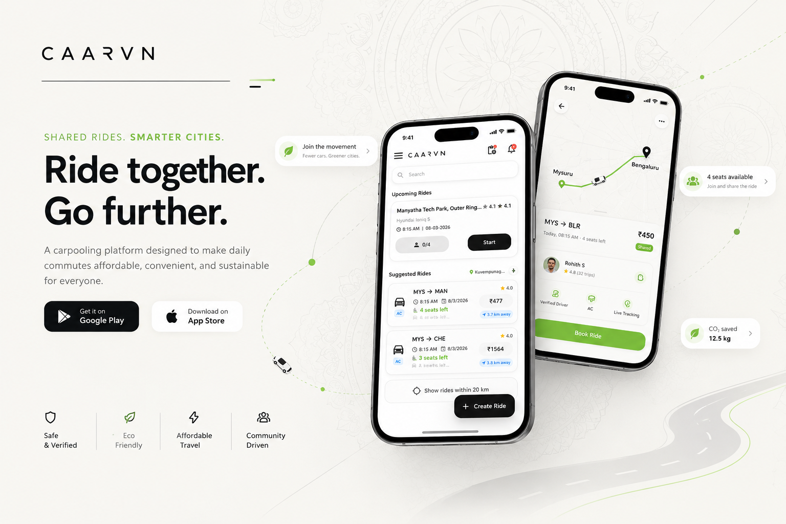

 

# H R U T H I K &nbsp; K &nbsp; T A R A V I

**Building useful apps. Solving real problems. One commit at a time.**

 

&nbsp;

&nbsp;

  

 

<table>
<tr>
<td width="55%" valign="middle">

## THE DEVELOPER

# I build apps. I solve problems. I ship products.

I'm a mobile application developer passionate about creating useful, intuitive digital experiences.

My work combines **Flutter mobile development, backend engineering, database integration, and cloud infrastructure**.

I enjoy taking ideas from concept to implementation, refining the user experience, and building applications for real-world use.

 

`BUILD` &nbsp; → &nbsp; `TEST` &nbsp; → &nbsp; `IMPROVE` &nbsp; → &nbsp; `SHIP`

</td>
<td width="45%" valign="middle">

</td>
</tr>
</table>

---

## MY FLAGSHIP PROJECT

# C A A R V N

### Shared rides. Smarter cities.

A carpooling platform designed to make daily commutes more affordable, convenient, and sustainable.

 

  

&nbsp;

  

<table>
<tr>
<td width="25%" align="center" valign="top">

### 01

**RIDE DISCOVERY**

Explore available rides and travel options.

</td>
<td width="25%" align="center" valign="top">

### 02

**RIDE MANAGEMENT**

Create rides, search, and coordinate shared journeys.

</td>
<td width="25%" align="center" valign="top">

### 03

**SAFETY**

Verification and safety-focused features.

</td>
<td width="25%" align="center" valign="top">

### 04

**INFRASTRUCTURE**

Mobile application, APIs, database, and cloud deployment.

</td>
</tr>
</table>

**BUILT WITH**

---

## WHAT I BUILD

<table>
<tr>
<td width="50%" valign="top">

### 01 / Mobile Development

Building cross-platform mobile applications with Flutter and Dart, with an emphasis on usability and clean interfaces.

</td>
<td width="50%" valign="top">

### 02 / Backend Engineering

Developing REST APIs, integrating databases, and connecting mobile interfaces to backend services.

</td>
</tr>
<tr>
<td width="50%" valign="top">

### 03 / Cloud & Infrastructure

Working with application deployment, server configuration, HTTPS, and cloud infrastructure.

</td>
<td width="50%" valign="top">

### 04 / Development Workflow

Prototyping, version control, interface refinement, and continuous improvement.

</td>
</tr>
</table>

---

## MORE THINGS I'VE BUILT

<table>
<tr>
<td width="50%" valign="top">

### EcoSync

**Carbon Credit Management**

A project focused on carbon-credit management and environmental monitoring.

- Carbon-credit registry concepts.
- Emissions monitoring and analytics.
- Blockchain-oriented transparency.

</td>
<td width="50%" valign="top">

### En-HanZ

**Handwriting Assistance**

A mobile application focused on supporting users who experience handwriting difficulties.

- Handwriting assistance.
- Dysgraphia screening support.
- Accessibility-focused user experience.

</td>
</tr>
</table>

---

## MILESTONES

<table>
<tr>
<td width="33%" align="center" valign="top">

### Finalist

Smart India Hackathon 2025

</td>
<td width="33%" align="center" valign="top">

### Winner

Horcrux Hackathon, PES University

</td>
<td width="33%" align="center" valign="top">

### Participant

Infothon & Ideathon

</td>
</tr>
</table>

---

## MY TOOLKIT

**MOBILE DEVELOPMENT**

  

**BACKEND & DATABASES**

  

**PROGRAMMING LANGUAGES**

  

**CLOUD & TOOLS**

---

 

# LET'S BUILD SOMETHING USEFUL.

  

&nbsp;

&nbsp;

  

Built with curiosity. Designed with purpose. Powered by commits.

  

